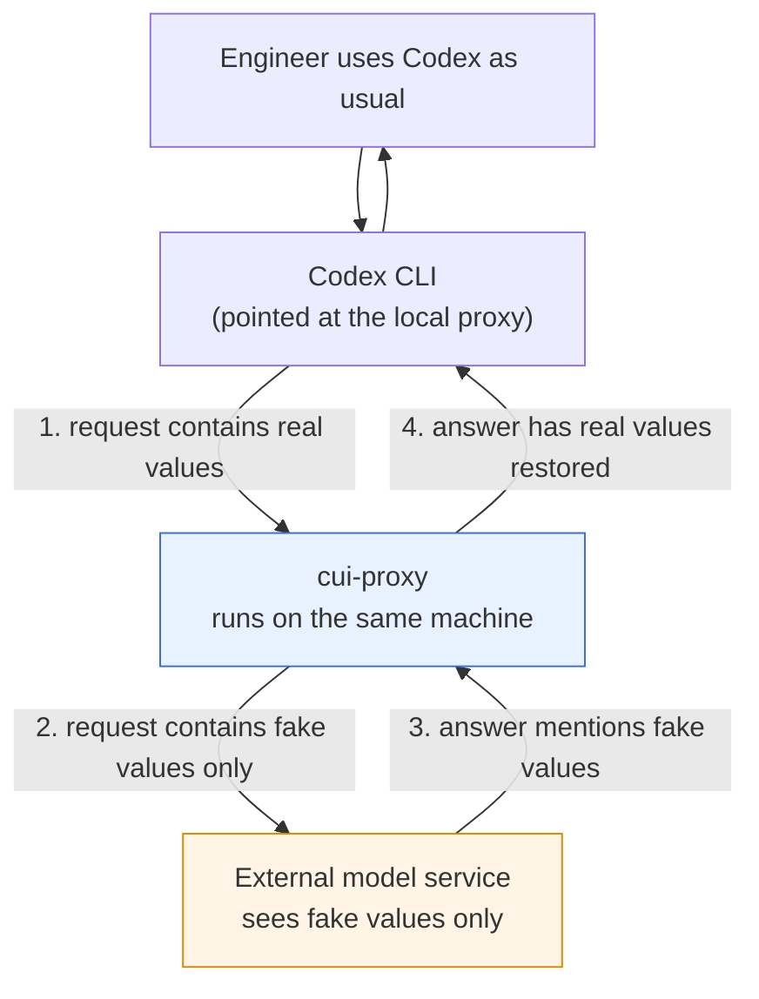
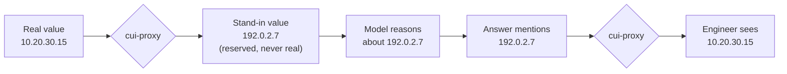
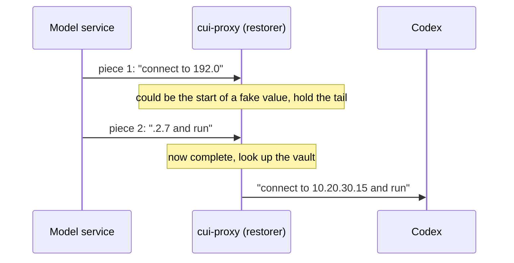
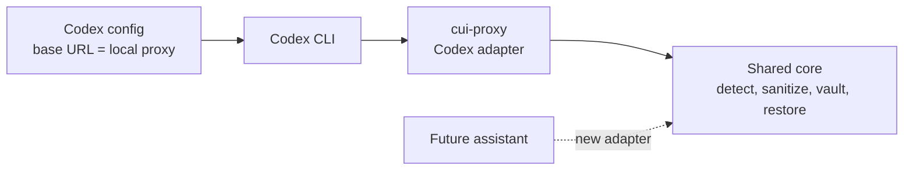
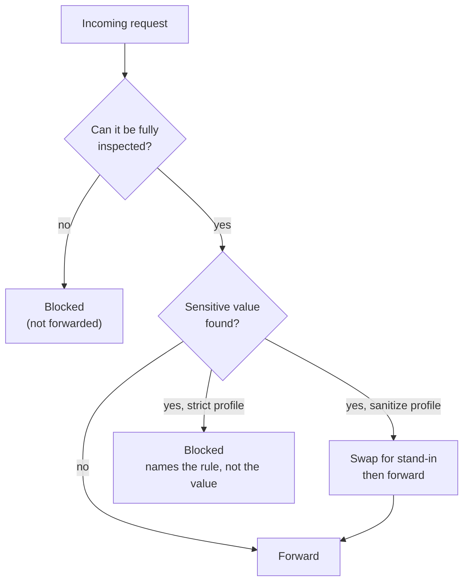
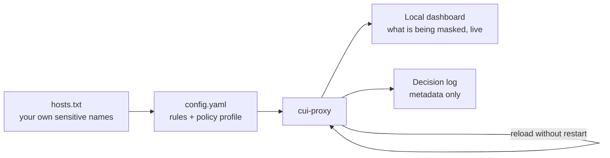

# cui-proxy: Executive Overview

*A high-level explanation of the idea, the key technologies, and the data flow.
Implementation detail is deliberately left out. Status: working software, not
yet validated against the real production model service (see
[Honest status](#honest-status)).*

---

## 1. The problem in one paragraph

AI coding assistants (such as Codex CLI) are most useful when they can see
real context: host names, IP addresses, cloud resource IDs, configuration
files, error output. In a government or regulated environment that context
often contains **CUI, customer identifiers, internal topology and
credentials**, and policy says it must not be sent to an external model
service. The usual answers are bad ones: ban the tool (lose the productivity),
or trust people to scrub every prompt by hand (they will miss things).

## 2. The idea in one sentence

> Put a small **local gatekeeper** between the assistant and the model service.
> It swaps sensitive values for **realistic fake ones** before anything leaves
> the machine, swaps the real ones back into the answer, and **refuses to send
> anything it cannot verify is clean**.

The assistant keeps working. The model never sees the real values. Nothing
about how the engineer works has to change.

## 3. What this is and is not

| It is | It is not |
|---|---|
| A risk-reduction layer that runs on the user's own machine | A compliance control or an approval to use AI with CUI |
| Fail-closed: when unsure, it blocks instead of forwarding | A DLP product or a guarantee that nothing sensitive leaves |
| Configurable per organization (your rules, your dictionary) | A replacement for GOVSEC / ISSM approval, which is still required |
| Auditable: every decision is logged without the data itself | A man-in-the-middle proxy (the assistant is pointed at it on purpose) |

Detection is pattern- and dictionary-based, so it can miss things. That is why
the design leans on blocking and on a strict mode (section 8).

---

## 4. End-to-end flow

Four moves:

1. **Intercept.** Codex sends its request to the proxy on `127.0.0.1`
   instead of to the internet.
2. **Sanitize.** The proxy finds sensitive values and replaces each with a
   realistic fake. Only the fake version leaves the machine.
3. **Model works on fakes.** The model reasons and answers using the fake
   values, because that is all it has.
4. **Restore.** As the answer streams back, the proxy swaps the fakes for the
   real values, so commands the assistant proposes run against real systems.

---

## 5. Key ideas that make it work

### 5.1 Synthetic data, not blanks

Replacing a value with `[REDACTED]` breaks the assistant: it can no longer
tell two servers apart or write a working command. Instead the proxy
substitutes **realistic, clearly non-real stand-ins**:

- IP addresses become addresses from ranges reserved for documentation
  (RFC 5737 / RFC 3849), which can never belong to a real host.
- Host and mail names become `.example` names, which can never resolve.
- Other identifiers (cloud IDs, tokens, card or SSN numbers) become
  same-shaped fake values.
- **Consistent within a session:** the same real value always maps to the
  same fake one, so the model's reasoning stays coherent ("server A talks to
  server B" still makes sense).

### 5.2 The vault: why a memory of the mapping must exist

To swap values *back*, the proxy has to remember which fake stood for which
real value. That memory is the **vault**:

- Holds the real-to-fake pairs, so the same value always gets the same fake
  and the answer can be restored.
- **Encrypted on disk** and local to the machine; never sent anywhere.
- Persists across restarts, so a long-running session keeps working.
- Without it, the proxy could hide data but could not give the assistant a
  usable answer.

### 5.3 Streaming (SSE) and why it matters

Model answers do not arrive as one block; they stream in small pieces
(Server-Sent Events) so the user sees text appear live. That creates a
subtle problem: **a fake value can be split across two pieces** (`192.0` in
one, `.2.7` in the next). A naive find-and-replace would miss it, and the
engineer would see the fake value, or worse, a command with the wrong address.

The proxy handles the stream as a stream:

- Reads the pieces as they arrive and holds back only the tail that *might*
  be the start of a fake value.
- Restores values correctly even when they are split, and also inside
  JSON-encoded text.
- Keeps the live, typing-as-it-goes experience instead of waiting for the
  whole answer.

### 5.4 How it hooks into Codex (no patching, no interception tricks)

Codex already supports choosing which service it talks to. The proxy uses that
supported setting:

- A few lines of Codex configuration point it at `http://127.0.0.1:8787`.
- Codex still uses its normal login; the proxy forwards credentials untouched
  and never stores them.
- Nothing is installed into Codex, and no network traffic is intercepted
  behind its back. Removing the setting removes the proxy.
- An **adapter** layer knows how to read Codex's request format. Supporting
  another assistant means writing another adapter, not rebuilding the product.

### 5.5 Fail closed: the safety posture

Most of the engineering effort goes into one rule: **if the proxy cannot be
sure a request is clean, it does not send it.** It blocks instead of guessing
when it meets:

- an unknown destination, an oversized or compressed body, or odd headers
  (things it cannot inspect);
- content it does not understand;
- a failure in its own safety machinery.

A block returns a clear message that names the *rule* that fired, never the
value. A failure never silently becomes a pass-through.

---

## 6. What the organization controls (configuration)

Everything is driven by two plain files on the user's machine. No code changes
are needed to adapt it to a different organization.

| What | Where | What it controls |
|---|---|---|
| **Rules** | `config.yaml` | Which kinds of data are detected (IP addresses, cloud IDs, emails, SSNs, card numbers, tokens) and what happens on a match |
| **Dictionary** | `hosts.txt` | The organization's *own* sensitive names (host names, project names, customer names), one per line. This is where local knowledge enters; no generic rule can know your internal names |
| **Policy profile** | `config.yaml` | `sanitize` (mask and restore, the default) or `strict` (any detection blocks the request) |
| **Allowed destination** | `config.yaml` | Which model service the proxy may talk to (must be HTTPS) |
| **Decision log** | `config.yaml` | Where the audit trail is written, retention, and what to do if it cannot be written |

**What end users need to decide or do:**

- Install it once (one command) and run it in the background; on macOS it
  is a menu-bar icon.
- Keep `hosts.txt` current with their own sensitive names. This is the single
  most valuable thing a user can do for detection quality.
- Pick a profile: `sanitize` for productivity, `strict` where the rule is
  "never send restricted data at all".
- Use a synthetic prompt first, and check the dashboard to see what is being
  masked.

---

## 7. Visibility and audit

- **Live dashboard** (local only): requests as they happen, which rules fired
  and how often, the active configuration, and a "test a string" box to
  preview what the rules do. It shows rule names and counts, never real
  values.
- **Decision log:** one line per request recording the decision (forwarded,
  sanitized, blocked), the reason, and the rule names. It never records the
  data itself, headers, or prompts. Entries are chained with hashes so that
  edits or missing entries in the middle of the log are detectable. A command
  verifies the chain and another explains in plain words why a request was
  blocked.
- **Fail closed on audit too:** under the strict profile, if the log cannot be
  written, the request is not sent.

The chain detects casual tampering. It does not prove the log is
tamper-proof against someone who can rewrite the whole file, and the
documentation says so.

## 8. Two postures, one tool

| | `sanitize` (default) | `strict` |
|---|---|---|
| Sensitive value found | Replaced with a stand-in, request continues | Whole request refused |
| Best for | Day-to-day engineering where masking is acceptable | Environments where policy forbids sending restricted data at all |
| Audit failure | Warns | Blocks |
| User experience | Seamless | User sees why it was blocked and removes the data |

---

## 9. Why this approach

- **Keeps the productivity:** the assistant still sees realistic structure, so
  it can still reason and write working commands. Blanking or banning loses
  that.
- **Works with the tools people already use:** a supported configuration
  setting, no patches, no changes to the assistant.
- **Local, with no new data custody:** nothing is sent to a third-party
  service to be cleaned. Mappings never leave the machine.
- **Safe by default:** blocks on doubt, and strict mode is available when
  policy demands it.
- **Adaptable and extensible:** the organization's own dictionary and rules;
  new assistants arrive as adapters.
- **Reviewable:** small single binary, open source, and the audit trail lets a
  reviewer see what was decided and why.

## 10. Honest status

- **Not a compliance control.** GOVSEC / ISSM approval for the use case is
  still required before any such data goes through it.
- **Detection is not perfect.** Pattern and dictionary matching will miss
  things; a missed value is sent as is. Strict mode and a good dictionary
  reduce, not remove, that risk.
- **Not yet validated against the real production model service.** The routing
  to the live ChatGPT-backed Codex endpoint has not been tested end to end; a
  manual smoke test is documented for that.
- **Some content cannot be inspected** (for example encrypted fields the
  assistant passes along); those are shape-checked, not scanned.
- **Approval workflow is not built yet.** Verifying that an organization has
  signed off on a given use, and allowed-account lists, are planned and
  waiting on what the approving authority actually issues.
