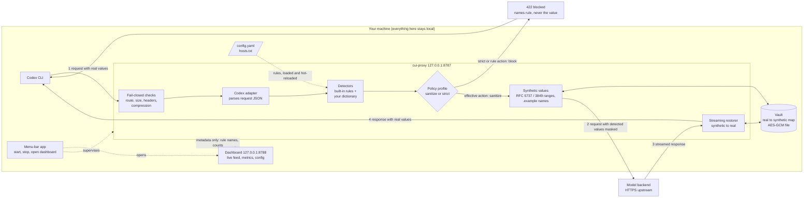

# cui-proxy

A local, fail-closed proxy for Codex CLI. It sits between Codex and the model
backend, replaces sensitive values in each request (IP addresses, OCIDs,
emails, SSNs, card numbers, tokens, and your own dictionary of host names)
with synthetic values from reserved ranges (RFC 5737 / RFC 3849 addresses,
`.example` host and mail names), and swaps the real values back into the
streamed response so tool calls run against your real systems.

> **Important: this tool reduces risk; it is not a compliance control.**
> It does not make it permissible to use a cloud model with CUI or other
> sensitive government data. Detection is pattern- and dictionary-based and
> will miss things. **You still need GOVSEC / ISSM approval** for your use
> case before sending any such data through it.

What it is not: not a DLP product, not a guarantee that nothing sensitive
leaves the machine, not a MITM proxy (Codex is pointed at it explicitly),
and it never stores or alters your upstream credentials.


## Contents

- [Quick start (macOS menu bar)](#quick-start-macos-menu-bar)
- [Quick start (terminal, Linux or no menu bar)](#quick-start-terminal-linux-or-no-menu-bar)
- [How it works](#how-it-works)
- [Everyday use](#everyday-use)
- [Decision log](#decision-log)
- [Known limitations (short list)](#known-limitations-short-list)
- [Documentation](#documentation)
- [Support](#support)

## Quick start (macOS menu bar)

The easiest way to run it: no terminal stays open, and one click opens the
dashboard. Four steps, about two minutes.

**1. Install**

```sh
brew install rozdolsky33/tap/cui-proxy
```

**2. Create your starter config**

```sh
cui-proxy init
```

Then put your own sensitive host names in `~/.config/cui-proxy/hosts.txt`, one
per line (the file explains the format).

**3. Install the menu-bar app**

```sh
cui-proxy menubar install
```

This compiles a tiny native app on your Mac (it needs Apple's Command Line
Tools: `xcode-select --install`), starts it, and starts the proxy for you. A
**shield icon** appears in the menu bar.

**4. Use it**

Click the shield:

- **Open Dashboard** shows live requests, metrics and the active config.
  Try the "test a string" box with `ssh admin@10.20.30.15`: you get a fake
  address back.
- **Copy Codex command**, then paste it in a terminal to run Codex through
  the proxy for one session. Use a synthetic prompt the first time.
- Tick **Start at Login** once and it is always there.

That is the whole setup. Everything else on this page is optional detail.
Not on a Mac, or prefer a terminal? See the next section.

> **Live backend smoke passed:** Codex CLI 0.167.0 with `gpt-6-astra` was
> verified on 2026-11-07 for routing, streamed value restoration, and a tool-call
> round trip. See [verification results](docs/verification.md) and
> [Known limitations](docs/limitations.md#known-limitations--behavior).

Codex workspace paths and Git remotes are sanitized from v0.3.2; no new
configuration is needed. Strict/block rules still reject matching metadata.
See [metadata verification](docs/verification.md#workspace-metadata-smoke-2026-11-08).

If the icon shows `!`, or Codex gets an error, see
[If the first Codex run fails](#if-the-first-codex-run-fails).

## Quick start (terminal, Linux or no menu bar)

```sh
brew install rozdolsky33/tap/cui-proxy              # or the curl installer, see docs/install.md
cui-proxy init                                      # writes ~/.config/cui-proxy/{config.yaml,hosts.txt}
$EDITOR ~/.config/cui-proxy/hosts.txt               # your own sensitive host names, one per line
cui-proxy check-config -config ~/.config/cui-proxy/config.yaml
cui-proxy serve -config ~/.config/cui-proxy/config.yaml     # leave this running
```

Then, in another terminal, point Codex at the proxy for one run (a permanent
setup is in [Point Codex at the proxy](docs/configuration.md#point-codex-at-the-proxy)). Use a
**synthetic prompt** the first time:

```sh
codex -c 'model_provider="cui-proxy"' \
      -c 'model_providers.cui-proxy={name="cui-proxy",base_url="http://127.0.0.1:8787/v1",wire_api="responses",requires_openai_auth=true}'
```

Dashboard: <http://127.0.0.1:8788/>. Stop the proxy with Ctrl-C.

### If the first Codex run fails

Look at the dashboard's *Blocked* column and the `cui-proxy` terminal (or
**Open Log** in the menu-bar app):

| You see | Likely cause |
|---|---|
| Nothing in the dashboard | Codex is not reaching the proxy: is it running, and did you pass the `-c` flags? |
| `403 route` or a 404 | Check that the configured upstream base and requested route match the supported Codex endpoints. See the symptom table in [docs/verification.md](docs/verification.md#5-what-to-look-for-first-prompt). |
| `422 request blocked ...` | A safety check refused the request; the message names the rule and kind, never the value. See [Block diagnostics](docs/block-diagnostics.md#block-diagnostics). |


## How it works



In words:

1. Codex sends its request to the proxy instead of the model backend. The
   proxy refuses anything it cannot inspect safely (unknown route, oversize or
   compressed body, bad headers) rather than forwarding it.
2. The detectors find sensitive values using the built-in rules and your own
   dictionary. Under the `strict` profile any match blocks the request.
   Under `sanitize` (the default), detected values are swapped for synthetic
   ones unless an explicit rule blocks. The pairs are stored in the vault.
3. The masked request is forwarded over HTTPS; unmatched content and
   documented inspection exceptions remain unchanged.
4. As the response streams back, the restorer replaces synthetic values with
   the real ones from the vault, so tool calls run against your real systems.

The dashboard and the menu-bar app only ever see metadata (rule names and
counts), never real values. Your upstream credentials pass through unchanged
and are never stored.

## Everyday use

| I want to... | Do this |
|---|---|
| Run Codex through the proxy | Menu bar: **Copy Codex command**, paste it. Or set it permanently: [Point Codex at the proxy](docs/configuration.md#point-codex-at-the-proxy). |
| See what is happening | Menu bar: **Open Dashboard**, or <http://127.0.0.1:8788/>. |
| Add a sensitive name | Add a line to `~/.config/cui-proxy/hosts.txt`, then **Reload rules** (menu bar) or `kill -HUP <pid>`. No restart. |
| Preview what the rules do | `echo 'ssh admin@10.20.30.15' \| cui-proxy test-rules -config ~/.config/cui-proxy/config.yaml` |
| Check my config is valid | `cui-proxy check-config -config ~/.config/cui-proxy/config.yaml` |
| Refuse restricted data instead of masking it | `cui-proxy policy init -profile strict`, see [Policy profiles](docs/policy.md#policy-profiles-sanitize-or-strict). |
| See what is and is not enforced | `cui-proxy policy check -config ~/.config/cui-proxy/config.yaml` |
| Find out why a request was blocked | The `422` message names the rule, never the value: [Block diagnostics](docs/block-diagnostics.md#block-diagnostics). |
| Check the state of the menu-bar app | `cui-proxy menubar status` |
| Upgrade | `brew update && brew upgrade cui-proxy`, then **Quit** and reopen the menu-bar app. |
| Remove it | [Uninstall](docs/install.md#uninstall) |

All commands and flags: [Commands](docs/configuration.md#commands).

## Decision log

Every request leaves one line in a log file on disk: **forwarded**, **sanitized**
or **blocked**, why, and which rules matched. It never contains the data
itself, headers, prompts, URLs or account ids. Lines are hash-chained, so an
edited, reordered or missing line in the middle is detectable.

```sh
cui-proxy audit verify -config ~/.config/cui-proxy/config.yaml    # check the chain, exit 1 on a break
cui-proxy explain -config ~/.config/cui-proxy/config.yaml <request-id>   # one decision in plain words
```

- **On by default**, in `~/.local/state/cui-proxy/decisions.jsonl` (mode 0600,
  in a private directory). Rotates at 50 MB and keeps 90 days by default.
- **Fail closed:** the record is written *before* the request is forwarded.
  Under `strict`, if it cannot be written the request is blocked (reason
  `audit`, HTTP 503). Under `sanitize` the default is to warn and continue.
- **Tamper-evident, not tamper-proof.** It does not catch a full rewrite with
  recomputed hashes or deletion of the newest lines. Do not name rules after
  sensitive things: rule names are recorded.

Settings, limits and details: [docs/decision-log.md](docs/decision-log.md).

## Known limitations (short list)

Read these before relying on it. The full list is in [docs/limitations.md](docs/limitations.md).

- Detection is pattern- and dictionary-based and **will miss things**; a missed value is sent as is.
- The upstream mapping passed one live smoke test (2026-11-07, Codex CLI 0.167.0, `gpt-6-astra`); that is evidence, not a guarantee. Repeat the checks in [docs/verification.md](docs/verification.md) after upgrades.
- Some content cannot be inspected (images, files, audio, encrypted fields) and is refused or only shape-checked.
- Credential headers pass through unchanged; the proxy never stores them.
- It protects only traffic that is pointed at it; it does not stop a client that bypasses it.

## Documentation

Operator guides below describe v0.3.2. Dated specs, plans and spikes are
historical records; ADR proposals include features that have not shipped.
See the [documentation status](docs/documentation-status.md) for that distinction.

| I want to... | Read |
|---|---|
| Understand the purpose and current scope | [Executive overview](EXECUTIVE-OVERVIEW.md) |
| Install, upgrade or uninstall (Homebrew, curl, manual) | [docs/install.md](docs/install.md) |
| Use the menu-bar app | [docs/menubar.md](docs/menubar.md) |
| Configure defaults, sanitize/strict, overrides, Git/SSH, reload and vault | [docs/configuration.md](docs/configuration.md) |
| Choose `sanitize` or `strict` | [docs/policy.md](docs/policy.md) |
| Understand a blocked request | [docs/block-diagnostics.md](docs/block-diagnostics.md) |
| Audit what the proxy decided | [docs/decision-log.md](docs/decision-log.md) |
| Know what it cannot do | [docs/limitations.md](docs/limitations.md) |
| Test it against real Codex | [docs/verification.md](docs/verification.md) |
| See why it works this way | [Design decisions (ADRs)](docs/adr/) |
| Read the threat model, evidence and operating requirements | [docs/assurance.md](docs/assurance.md) |
| Build or release it | [docs/development.md](docs/development.md) |

See [assurance and operations](docs/assurance.md) for the reviewed threat
model, verification evidence, operating requirements, and remaining limits.

## Support

- Questions, bugs, feature requests: [GitHub issues](https://github.com/rozdolsky33/cui-proxy/issues).
  **Never paste real sensitive data into an issue or log excerpt**; use made-up values of the same shape.
- Security problems (a way around the protections, a leak): report privately, see [SECURITY.md](SECURITY.md).
- Best-effort software under the [MIT license](LICENSE), no warranty, and not an approved compliance control.
