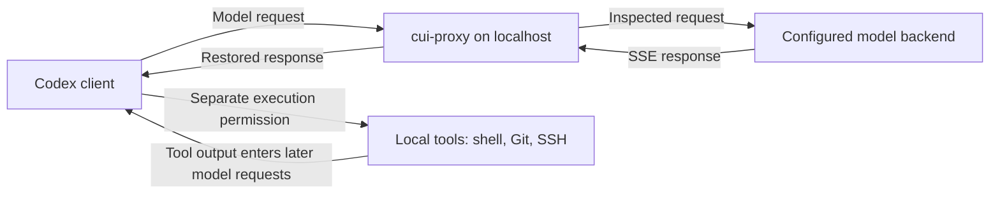
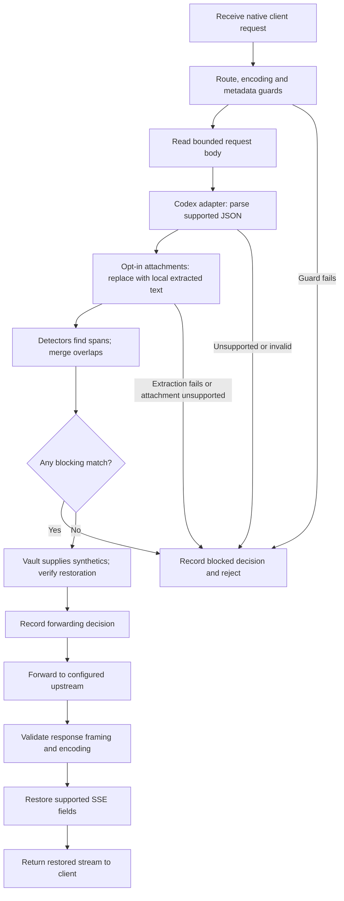

# How cui-proxy handles a request

cui-proxy sits between a configured Codex client and its model backend. It
replaces detected values before forwarding supported requests, keeps a local
mapping, and restores known replacements in supported response fields. It is
a pattern-based exposure reduction tool, not a complete data classifier or a
compliance guarantee.

Start with the [quick start](quickstart.md), follow the [tutorial](tutorial.md),
or use [Codex setup](codex.md) to connect a client.

## Where the proxy sits

Only traffic routed through the proxy is inspected. Git, SSH, shell commands,
and their network connections do not run through this HTTP proxy. A command,
remote URL, or tool result can nevertheless be detected when Codex sends it
to the model on a later turn. Command approval and SSH authentication are
separate from proxy policy.

The proxy API and dashboard use separate localhost listeners, conventionally
ports 8787 and 8788. The native-client guard rejects browser Origin and Fetch
Metadata requests; in loopback mode it also checks Host to resist DNS
rebinding. Non-loopback binding requires an explicit setting and does not add
authentication or TLS. Other native processes running as the same OS user are
inside the local trust boundary.

## The request lifecycle

1. **Take the active configuration snapshot.** A request uses a consistent
   policy, sanitizer, and restorer. Rule reloads affect later requests.
2. **Apply guards.** The adapter accepts `POST /v1/responses` and
   `GET /v1/models`; it strips `/v1` for the upstream route. Unknown routes,
   compressed request bodies, unsuitable native-client headers, and detected
   values in fields that cannot be rewritten are refused. Model listings are
   a body-free passthrough route, with the request guards still applied.
3. **Inspect metadata.** The Codex adapter decodes
   `X-Codex-Turn-Metadata` and sanitizes `workspaces` and `cwd`, including
   workspace map keys and remote URLs. Other metadata fields are inspected
   without rewriting. Malformed, repeated, oversized, or over-deep metadata
   fails closed. The fixed metadata limit is 64 KiB.
4. **Parse the body.** The Responses request must be a single valid UTF-8 JSON
   object, within the configured body limit (20 MiB by default) and fixed
   nesting limit of 64 containers. Attachments default to block. With the
   [extraction setting](attachments.md), supported inline PDFs and
   PNG/JPEG images become local text before detection; filenames and binary
   bytes are dropped. File references, audio and other unsupported forms block.
   Extraction limits and failures always block, including under passthrough.
5. **Detect and decide.** All configured detectors run on supported values.
   Overlaps become a union so a shorter match cannot leave part of another
   detected value exposed. Any effective blocking match rejects the request
   before forwarding; otherwise the sanitizer replaces the detected spans.
6. **Allocate mappings and check restoration.** The vault reserves detected
   originals, avoids collisions, and supplies stable synthetics. The sanitizer
   checks that the restorer can find exactly the inserted replacements. A
   bounded replacement that fails that check is retried as an opaque `secret`
   token; a failed retry blocks by default.
7. **Record the decision and forward.** The decision log is written before
   forwarding. It records metadata such as request ID, outcome, rule names,
   and counts, without request text or original values. With strict policy, a
   failed audit write prevents forwarding. Sanitize defaults to warning and
   continuing on an audit failure; set `audit.on_error: block` to require it.
8. **Restore the supported stream.** The response adapter recognizes SSE
   events, restores known synthetics in supported fields, and sends the result
   back with `Cache-Control: no-store`.

## What is inspected and what stays unchanged

| Location | Behavior |
|---|---|
| Prompt text, instructions, tool descriptions and results, schema strings, ordinary string leaves | Detect and sanitize, or block according to effective action |
| Non-protocol object keys | Inspected too: sensitive values can be used as map keys |
| Strings containing valid JSON objects or arrays | Parse recursively and inspect decoded keys and leaves, including escaped text |
| Integer literals | Inspect; a sanitized integer becomes a JSON string |
| Decimal and exponent numbers | Check original and exact expanded digits; detected values are refused to avoid a lossy rewrite; exponents outside ±400 are refused |
| Known protocol identifiers such as model, role, tool names and IDs at their protocol positions | Preserve; when any rule blocks, check against blocking rules without rewriting |
| Known `include` values | Preserve as protocol entries; unknown entries are inspected |
| Vendor `encrypted_content` in reasoning/compaction items | Preserve unscanned; with any blocking rule, require base64/base64url-shaped content |
| Workspace `cwd` and `workspaces` metadata | Sanitize or block using the body rules and vault |
| Remaining metadata, non-credential headers and query string | Inspect; any detection blocks because these fields are not safely rewritten |
| `Authorization`, `Cookie`, `Chatgpt-Account-Id` headers | Forward as credentials, unscanned and unchanged |

Nested JSON is inspected as data, not by running a regex over serialized escape
syntax. Matches that cross JSON structural tokens cannot be safely rewritten
and are refused. A string merely named `id` in arbitrary tool data does not
automatically receive the protocol exemption.

Encrypted reasoning remains a boundary: a value written entirely in the
accepted ciphertext alphabet could pass there. Credential passthrough is also
intentional; the proxy must retain the credentials needed by the upstream.

## The vault and response restoration

The vault holds both directions of each mapping: original to synthetic and
synthetic to original. Derivation uses a keyed HMAC and the replacement class;
collision checks keep synthetics distinct from known originals and existing
mappings. Reusing the same mapping lets Codex resend conversation history
without repeatedly masking an issued synthetic. An ambiguous address from
the IPv4 overflow pool is treated more cautiously and can block.

| Vault mode | Operational consequence |
|---|---|
| `memory` | Mappings disappear on restart; an old conversation's synthetics may no longer restore |
| `file` | Mappings are persisted encrypted with AES-256-GCM and a local key file; protect both files and preserve them together |

File mode saves changed mappings periodically (every 30 seconds by default)
and on graceful shutdown. An abrupt process or machine failure can lose changes
since the last successful save; it is not a per-request durable transaction.

The vault contains originals and is sensitive even though the decision log
does not contain them. The [configuration guide](configuration.md) explains
file paths and restart requirements; [rules](rules.md#replacement-classes)
explains the available shapes.

Supported streamed deltas include output text, refusals, reasoning summaries,
function-call arguments, and custom tool input. The restorer buffers incomplete
synthetic prefixes across chunks. Function-call arguments are handled as JSON,
so restored quotes, backslashes, escaped text, keys, and numeric values retain
valid structure. They have a fixed 20 MiB cumulative argument-delta input limit
per response and a 20 MiB completed argument-document limit. Invalid or
unfinished argument JSON cuts the stream.

Restoration is field-aware. Protocol identifiers, opaque blobs, unknown delta
event types, and non-summary reasoning content are not broadly rewritten.
The model must return a known synthetic in a supported field for restoration
to occur; paraphrased or modified replacements are not guaranteed to restore.

Successful model responses must be unencoded SSE. Unlabelled SSE can be
recognized using a bounded framing probe; unrecognized successful bodies fail
closed with `stream_rewrite`. Ordinary upstream error responses and model
listings preserve their status and body. Redirects other than 304 are refused,
so a client cannot follow a redirected request outside the configured route.

## Decisions, errors, and practical limits

A policy match is a decision, not a sanitizer error. A blocking rule cannot be
overridden by `policy.on_error`. Unsupported content also always blocks.
The optional `policy.on_error: passthrough` setting applies only to eligible
sanitizer failures and can forward the original body; it is invalid with
strict policy or any explicit blocking rule. Keep the default `block` unless
you have deliberately accepted that exposure.

The decision log records the decision made before forwarding, not proof of
successful model completion. A later upstream or stream failure can follow a
recorded forwarding decision. See the [decision log](decision-log.md) and
[troubleshooting](troubleshooting.md) for interpretation.

Patterns can miss sensitive content. The built-in bundle does not discover
every hostname, username, path, or organization identifier. Add relevant
dictionary and regex rules, test with fabricated values, and review
[limitations](limitations.md) before depending on a policy.

Continue with [rule mechanics](rules.md), [policy profiles](policy.md),
[testing](testing.md), the [dashboard](dashboard.md), or the complete
[reference](reference.md). The [glossary](glossary.md) explains the terminology.
