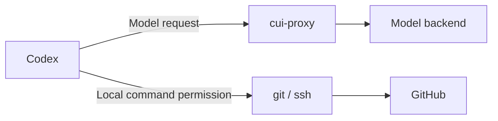

# Configuration walkthrough and reference

Checked against v0.3.2 on 2026-11-08. This guide describes implemented
settings. Planned approval/account allowlists in the ADRs are not available.

Start with [which file to edit](#which-file-to-edit), then
[choose a policy](#sanitize-strict-and-overrides). For a blocked Git operation,
go to [Git and SSH troubleshooting](#git-and-ssh-troubleshooting).

## Which file to edit

| File / setting | Controls | Does not control |
|---|---|---|
| Proxy `config.yaml`, normally `~/.config/cui-proxy/config.yaml` | Detection rules, masking/blocking, listeners, upstream, vault, audit | SSH keys or the agent's permission to run a command |
| Dictionary files, normally `hosts.txt` beside the YAML | Literal sensitive names used by a `type: dictionary` rule | An allowlist: adding a name increases detection |
| `~/.codex/config.toml` | Codex's model-provider selection and URL; separate Codex settings | Proxy rule actions: Codex `-c` cannot override the proxy YAML |
| Git repository `.git/config`, SSH configuration/agent | Git remote URL and SSH authentication/transport | Whether model requests pass proxy inspection |

`cui-proxy init` creates `config.yaml` and `hosts.txt` in
`$XDG_CONFIG_HOME/cui-proxy`, if set, otherwise `~/.config/cui-proxy`.
`init -dir PATH` chooses another directory. It writes starter files; it does
not select them for an already running service. Do not use `init -force` to
change one setting: it overwrites both files, including your dictionary.

`serve`, `check-config`, `policy check` and `test-rules` require an explicit
`-config PATH`. The menu-bar installer chooses the default config directory
unless installed with `menubar install -config PATH`; **Open Config Folder**
opens the folder for that installation. Edit the file used by the running
proxy, not an unused copy in a repository. Check the dashboard's effective
configuration and startup log after applying changes.

The proxy loads one YAML document. It does not merge global and project
files, interpolate environment variables inside YAML, or implement
`--set`/per-request policy overrides. Unknown YAML fields are rejected.
Dictionary, vault and audit relative paths resolve against the YAML file's
directory. `~` inside YAML is not expanded; use an absolute or relative path.
Shell `~` in a command argument is expanded by your shell.

## First setup and a safe edit cycle

For a new installation only:

```sh
cui-proxy init
```

For an existing installation, edit its YAML directly. These commands assume
the default location; substitute your actual path if it differs:

```sh
cp ~/.config/cui-proxy/config.yaml ~/.config/cui-proxy/config.yaml.backup
cui-proxy version
cui-proxy check-config -config ~/.config/cui-proxy/config.yaml
cui-proxy policy check -config ~/.config/cui-proxy/config.yaml
printf '%s\n' 'git@github.com:example/demo.git host=10.20.30.15' |
  cui-proxy test-rules -config ~/.config/cui-proxy/config.yaml
```

`test-rules` uses a temporary vault and tests text detection, not a complete
HTTP request, header parsing, SSH connection or round trip. Use fabricated
input: its output is intended for the operator and can include original
unmatched text. `check-config` may also print detailed configuration errors.

After validation, choose **Reload rules** in the menu bar or dashboard for
reloadable settings. Restart for the settings marked below. A reload failure
leaves the old rules active. For rollback, restore the backup, validate it,
and reload or restart as appropriate. Avoid running a second proxy on the
same ports or file vault.

## Sanitize, strict, and overrides

| Situation | `sanitize` (default) | `strict` |
|---|---|---|
| Detected value in supported content or workspace metadata | Mask it; restore eligible model-response text locally | Reject the entire request |
| Rule explicitly says `action: block` | Reject the entire request | Reject the entire request |
| Rule explicitly says `action: sanitize` | Mask it | Invalid configuration |
| Unsupported content, invalid metadata, unknown route | Reject | Reject |
| Detection in another header/query or unchanged metadata field | Reject; those fields cannot be safely rewritten | Reject |
| Audit write fails, with defaults | Warn and continue | Reject |

`sanitize` means "mask what matches", not "allow everything". `strict` means
"block detections", not "guarantee that nothing sensitive gets through".
Unrecognized values are not protected by either profile.

For everyday work where masking is appropriate, edit the existing blocks:

```yaml
policy:
  profile: sanitize
  on_error: block
  unsupported: block
  max_body_bytes: 20971520
```

Keep your current `rules`, upstream, vault and audit settings. Remove an
explicit `action: block` only from rules you intend to change to masking,
or set those rules to `action: sanitize`. Changing the profile alone does
not override explicit blocking rules.

For strict operation, set `policy.profile: strict`, retain
`policy.on_error: block`, remove all explicit `action: sanitize` entries,
and ensure audit is enabled with `audit.on_error: block` (or omitted so the
profile default applies). At least one rule is required. To make a separate
starter without overwriting your live files:

```sh
cui-proxy init -dir /tmp/cui-strict-example -profile strict
cui-proxy check-config -config /tmp/cui-strict-example/config.yaml
```

### Flexible masking with selected hard blocks

This is a complete example. Save it beside a `restricted-names.txt` dictionary
containing fabricated entries such as `restricted-project` before testing:

```yaml
listen: 127.0.0.1:8787
ui:
  listen: 127.0.0.1:8788
upstreams:
  codex: https://chatgpt.com/backend-api/codex
policy:
  profile: sanitize
  on_error: block
vault:
  mode: memory
audit:
  enabled: true
  on_error: block
rules:
  - name: builtin
    type: builtin
    action: sanitize
  - name: restricted-names
    type: dictionary
    file: restricted-names.txt
    synth: hostname
    action: block
  - name: aws-keys
    type: regex
    pattern: '\b(?:AKIA|ASIA)[0-9A-Z]{16}\b'
    synth: secret
    action: block
```

Built-in matches are masked, while the two explicit rules block. A block
wins if it overlaps a sanitizing rule; a later rule cannot cancel it.
This example sets audit failure to block explicitly, which is stronger
than the sanitize profile's default `warn`.

### Overrides that exist, and ones that do not

| Want to change | Supported way / limit |
|---|---|
| Block a category while masking others | `profile: sanitize` plus `action: block` on selected rules |
| Change a custom match | Edit its regex or dictionary and reload |
| Stop using a rule | Remove its YAML entry and reload; this stops that detection everywhere the rule applied |
| Allow one public value while keeping the same detector | No `allow`, `exclude`, exceptions list, or `action: allow` in v0.3.2 |
| Disable just `builtin.email` | No selector for individual built-in detectors. `type: builtin` expands to the entire bundle |
| Override a strict detection | Not supported; `action: sanitize` under strict is invalid |
| Use a custom set instead of the built-in bundle | Remove the bundle and supply custom rules, but this removes every built-in protection not recreated; adding a narrower regex alongside the bundle does not narrow it |
| Different policies for different repositories | Separate YAML files and proxy instances on different ports, with separate file vaults/audit logs, and explicit client routing; no automatic repository profiles |
| Allow unsupported input or malformed metadata | Not configurable; `unsupported: block` is the only value |
| Approve `git push` / allow an SSH destination | No proxy option; execution permission and Git/SSH transport are separate |

There is no general "ignore this block" switch. `policy.on_error:
passthrough` only forwards the original body for eligible sanitizer failures
(such as synthetic pool exhaustion). It does not override policy matches,
metadata failures, `bad_body`, depth/size limits, or unsupported content.
It is invalid with strict or any blocking rule, and can expose original
values when used. It is not a remedy for Git remote detection.

## Git and SSH troubleshooting

There are two paths:



The proxy does not open, authorize or filter the SSH socket. It can block a
model request containing a remote URL, proposed command, or earlier tool
output. That can stop the agent's next turn even though SSH itself works.

| What you see | Where to investigate | Can proxy YAML fix it? |
|---|---|---|
| `422 reason=header ... rule=builtin.email` | Workspace metadata, another header, or query | v0.3.2 sanitizes `workspaces` and `cwd`; strict/explicit blocks and other header matches still block |
| `422 reason=policy kind=rule_match` | Active profile and named blocking rule | Use masking only if appropriate, or narrow the offending custom rule; a strict exception is unavailable |
| `422 reason=sanitize kind=bad_body` | Request shape/content | No blanket override. Images/files/audio, invalid JSON, or other unsupported representations can trigger it; capture a synthetic reproduction |
| `Permission denied (publickey)` | SSH key/agent, GitHub identity and repository permissions | No |
| Connection timeout, DNS failure, connection refused | Network, firewall, VPN, SSH endpoint | No |
| Codex command approval/sandbox denial | The agent's execution permissions | No; approve the needed action through the supported permission flow |
| `non-fast-forward` or repository authorization error | Git branch state or repository access | No |

Codex command and network approvals are separate from proxy content policy;
use the narrow permission appropriate to the intended operation. See
[OpenAI's explanation of command and network permissions](https://developers.openai.com/blog/mastering-codex-remote-for-engineering#6-treat-permissions-as-part-of-the-workflow).

For `git@github.com:example/demo.git`, the email detector matches the
`git@github.com` portion. In v0.3.2 with `sanitize` and no applicable blocking
rule, supported prompt text and workspace metadata are masked rather than
rejected. No SSH allowlist or disabled email detector is needed. Eligible
response text is restored before the local command runs.

Work through these checks:

1. Confirm `cui-proxy version`, then restart the running service after an
   upgrade. A new binary on your shell's PATH does not update an old process;
   the menu-bar app may also use a different binary path. Check its startup log.
2. Run `policy check` with the actual service config and check the dashboard's
   active profile. Look for `strict` or explicit blocking rules.
3. Use `explain -config PATH REQUEST-ID` and the proxy log's reason/kind/rule.
   `header` does not prove the workspace field was responsible; other headers
   and queries remain blocking. Do not post raw headers or credentials.
4. Test the fabricated remote above with `test-rules`. For full metadata
   handling, use the [workspace smoke](verification.md#workspace-metadata-smoke-2026-11-08).
5. If the error is from Git/SSH rather than the proxy, inspect that separately.
   A read-only `git ls-remote origin` from the same repository tests remote
   access without pushing or changing local branches. It contacts the remote
   and may still need the agent's network approval. If it works in your terminal
   but not the agent, compare execution permissions and SSH-agent environment.

Switching an SSH remote to HTTPS is a transport choice, not a proxy policy
exception. It does not fix unsupported request bodies or other sensitive
content. Changing a remote is unnecessary for the v0.3.2 metadata fix.

## Defaults and all configurable fields

Defaults below are loader defaults, not every value in the starter file.
Omitting `rules` does **not** enable built-ins automatically. `init` writes
three entries: the built-in bundle, a dictionary, and an AWS-key regex.
A sanitize config with no rules can validate but masks no detected values;
strict refuses an empty rule list. The selected adapter needs an upstream;
there is no default upstream in the loader.

| YAML field | Default | Meaning / accepted values | Apply |
|---|---|---|---|
| `listen` | `127.0.0.1:8787` | Proxy bind address | Restart |
| `ui.listen` | `127.0.0.1:8788` | Dashboard bind address; empty uses default, not disabled | Restart |
| `allow_non_loopback` | `false` | Permit non-loopback bind addresses; does not add auth/TLS; menu-bar app requires loopback | Restart |
| `upstreams.codex` | None; starter uses ChatGPT backend | Absolute base URL; no embedded credentials, query or fragment; HTTPS, or HTTP loopback for testing | Restart |
| `policy.profile` | `sanitize` | `sanitize` or `strict` | Reload |
| `policy.on_error` | `block` | `block` or restricted, unsafe `passthrough` behavior above | Reload |
| `policy.unsupported` | `block` | Only `block` accepted | Fixed behavior |
| `policy.max_body_bytes` | `20971520` (20 MiB) | Request body limit in bytes; positive integer; zero uses default, not unlimited | Reload |
| `vault.mode` | `memory` | `memory` or encrypted `file` | Restart |
| `vault.file` | None | Required with file mode | Restart |
| `vault.key_file` | None | Required with file mode; 32-byte key, created 0600 | Restart |
| `audit.enabled` | `true` | `false` allowed only under sanitize | Restart |
| `audit.file` | `$XDG_STATE_HOME/cui-proxy/decisions.jsonl` if absolute; otherwise `~/.local/state/cui-proxy/decisions.jsonl` | Value-free decision log, private directory | Restart |
| `audit.on_error` | `warn` under sanitize; `block` under strict | Write-failure handling; strict requires block | Restart for explicit setting changes |
| `audit.max_size_mb` | `50` | Rotation size, 1–1048576; binary MiB | Restart |
| `audit.retention_days` | `90` | 0–106751; 0 retains indefinitely; newest rotated file kept | Restart |
| `rules` | Empty list | Rules below; not merged with starter rules | Reload |

The 64 KiB turn-metadata limit and JSON depth limit are not YAML options.
Increasing `max_body_bytes` does not increase those limits.

### Rule fields

| Field | Applies to | Meaning |
|---|---|---|
| `name` | All, required | Unique rule name; recorded in diagnostics, so use category names rather than secrets |
| `type` | All, required | `builtin`, `dictionary`, `regex` |
| `action` | All | Omitted follows profile; `sanitize` or `block`; cannot weaken strict |
| `pattern` | Regex, required | Go regexp syntax; whole match is masked, not just capture group 1; no lookaround/backreferences |
| `validate` | Regex, optional | `ipv4`, `ssn`, `luhn`, or `ocid`; rejects invalid candidates; omitted means no extra validator |
| `file` | Dictionary, required | Dictionary filename, relative to YAML directory or absolute |
| `synth` | Regex/dictionary, required | Replacement class: `ipv4`, `ipv6`, `cidr`, `hostname`, `email`, `ocid`, `ssn`, `card`, `secret` |

Built-in rules choose their own patterns and classes; `pattern`, `validate`,
`file` and `synth` are not ways to customize that bundle. The bundle detects
OCIDs, IPv4/IPv6/CIDR, address-plus-port tokens, emails, SSNs, card numbers,
bearer tokens, JWTs and private-key blocks. It does not detect arbitrary
usernames, repository paths or hostnames without suitable custom rules.

Dictionary files use one literal per line, ignore blank lines and lines
starting with `#`, and match case-insensitively at alphanumeric boundaries.
They are not regex files. A dictionary with no usable entries is rejected.
Use `synth: secret` for opaque custom identifiers; choose address classes only
when the matched value is a suitable address. A mischosen class can fail
sanitization. All rules run: order is not an allow/block firewall list.

## Point Codex at the proxy

In `~/.codex/config.toml` (or a profile):

```toml
model_provider = "cui-proxy"

[model_providers.cui-proxy]
name = "cui-proxy"
base_url = "http://127.0.0.1:8787/v1"
wire_api = "responses"
requires_openai_auth = true
```

Or for a single run:

```sh
codex -c 'model_provider="cui-proxy"' \
      -c 'model_providers.cui-proxy={name="cui-proxy",base_url="http://127.0.0.1:8787/v1",wire_api="responses",requires_openai_auth=true}'
```

`requires_openai_auth = true` makes Codex send its ChatGPT login headers to
the proxy, which forwards them unchanged to the upstream.

The upstream mapping (`/v1/responses` ->
`https://chatgpt.com/backend-api/codex/responses`) passed a live smoke test
on 2026-11-07 with Codex CLI 0.167.0 and `gpt-6-astra`, including streamed
restoration and a shell tool round trip. See [verification.md](verification.md)
for evidence, scope, and repeatable checks.

## Commands

| Command | Purpose |
|---|---|
| `init [-dir PATH] [-force] [-profile sanitize\|strict]` | Write a starter `config.yaml` and `hosts.txt` (mode 0600) into `$XDG_CONFIG_HOME/cui-proxy`, else `~/.config/cui-proxy`. Never overwrites without `-force`. |
| `policy init [-profile ...]` / `policy check -config PATH [-require-strict]` | `init` is the same as above; `check` validates the policy and says what is and is not enforced. |
| `menubar install\|uninstall\|status` | macOS only: build and manage the menu-bar app that runs the proxy in the background. |
| `info -config PATH` | Print the proxy and dashboard URLs for a config (used by the menu-bar app). |
| `serve -config PATH [-adapter codex]` | Run the proxy (default `127.0.0.1:8787`) and the dashboard (default `127.0.0.1:8788`). |
| `check-config -config PATH [-adapter NAME]` | Validate the config, rule files and selected adapter/upstream; prints `ok: <N> rules`, exits 1 on error. |
| `audit verify [-file PATH \| -config PATH]` | Check the decision log's hash chain across the active and rotated files; exit 1 on a break. |
| `explain [-config PATH] REQUEST-ID` | Say in plain words why a request was forwarded, sanitized or blocked, from the decision log. |
| `test-rules -config PATH` | Read stdin (max 8 MiB), print the sanitized text to stdout and a rule/class/count table to stderr. Uses a throwaway vault. |
| `version` | Print the version. |

Exit codes: 0 ok, 1 failure, 2 usage error.

The upstream for ChatGPT-login Codex is configured in the proxy config:

```yaml
upstreams:
  codex: https://chatgpt.com/backend-api/codex
```

The upstream must be `https` (plain `http` is accepted only for a loopback
host, for testing). See `examples/config.yaml` for the full, commented
config. Relative dictionary and vault paths resolve against the config
file's directory.

## Dashboard

<http://127.0.0.1:8788/> shows the live request feed (rule names and counts,
never values), metrics, the effective config, a "test a string" box, and a
reload button. It is bound to localhost and refuses non-localhost `Host`
headers and cross-origin POSTs.

## Hot reload

`kill -HUP <pid>` or the dashboard's reload button re-reads the config file
and the dictionary files. The new rules apply only if the whole config is
valid; otherwise the running rules stay and the error is shown. Requests
already in flight finish with the rules they started with. The vault (and so
every existing mapping) is kept.

Applied on reload: `rules` (and dictionary contents), `policy.profile`, `policy.on_error`,
`policy.max_body_bytes`.
Need a restart (a reload logs `WARN restart required for: ...` and keeps the
running values): `listen`, `ui.listen`, `upstreams`, `vault.*`,
`allow_non_loopback`, all `audit.*` settings.

When audit failure handling was omitted, a profile change is not treated as
an explicit audit-setting edit. Strict still forces audit failures to block.
A reload to strict is refused if audit was disabled at startup; enable it
and restart first. See [decision-log.md](decision-log.md) for details.

`SIGINT` / `SIGTERM` stop the proxy with a 10 s drain for in-flight requests;
a second signal closes at once.

## Vault

- `vault.mode: memory` (default): mappings live only in the process, under a
  random key that never touches disk. After a restart, synthetic values in
  history that Codex resends are unknown to the new vault and pass through
  unrestored.
- `vault.mode: file`: mappings are stored encrypted (AES-256-GCM, file format
  `CUIV2`) in `vault.file`, keyed by `vault.key_file` (32 bytes, created with
  mode 0600 on first run; a key file with wider permissions is refused). The
  vault is saved every 30 s when it changed and on shutdown. A vault file that
  cannot be read (wrong key, missing key file, older format, corruption) stops
  startup; it is never silently replaced. To start over, remove the vault
  file yourself. Only one process may own a file vault: a lifetime lock
  prevents stale writers from overwriting mappings. Keep its parent directory
  private. A crash can still lose changes since the last periodic save.

### Synthetic address pool

IPv4 (and CIDR) synthetics come from the 762 RFC 5737 documentation
addresses (`192.0.2.x`, `198.51.100.x`, `203.0.113.x`). When those are
used up, the vault falls back to an overflow pool of 130,048 addresses in
`198.18.0.0/15` (RFC 2544 benchmarking).

- Exhaustion: when no synthetic is left, the request is blocked (HTTP 422,
  code `sanitize`, kind `pool_exhausted`; nothing is forwarded; see
  [Block diagnostics](block-diagnostics.md#block-diagnostics)). Mappings are never
  freed: the vault keeps growing for the life of the process (and of the
  vault file in file mode), and even a blocked request may have used up
  addresses.
- Under `policy.on_error: passthrough`, exhaustion is a sanitize failure, so
  the original body, with its real IPs, can be forwarded. Successfully
  sanitized workspace metadata stays masked; metadata failures still block.
- `198.18.0.0/15` can carry real traffic (lab and benchmark networks, and
  proxies or VPNs with a "fake-IP" mode). To keep a real address there from
  being confused with a synthetic: once the vault has seen any real address
  in that range, it stops coining overflow addresses (it then fails closed
  after the 762 RFC 5737 addresses); and a request containing an address
  that equals an existing overflow synthetic is blocked, because the proxy
  cannot tell whether it is real. Leading-zero spellings
  (`198.018.001.001`) count as the same address, and an IPv4/CIDR value that
  cannot be parsed also disables the overflow pool. In file mode this
  decision is saved with the vault and survives restarts. Each exact
  spelling still gets its own synthetic and restores byte for byte (some
  tools read leading-zero octets as octal); no synthetic ever equals any
  spelling of a known real. Residual risk: if your real traffic uses
  that range, expect blocks. A model reply that names a real
  `198.18.0.0/15` address the proxy has issued as a synthetic is restored to
  the wrong value.
