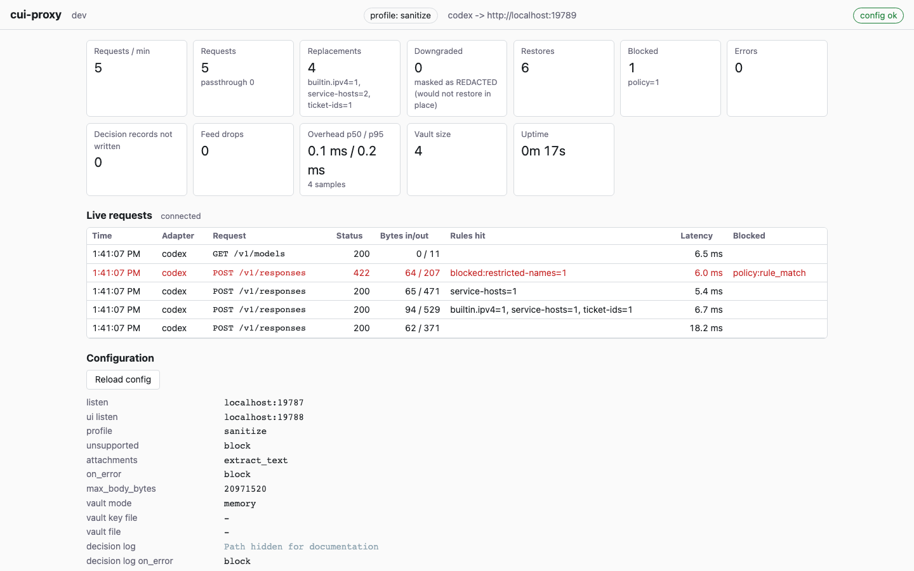
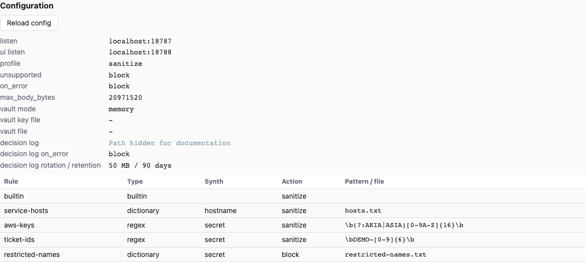
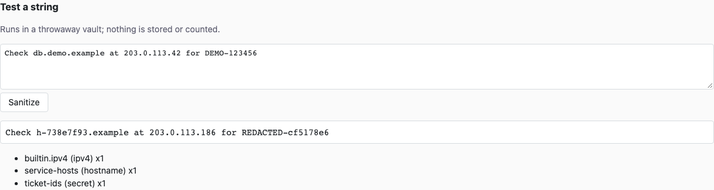

# Dashboard

The dashboard shows what the running proxy is doing and lets you test rules
without sending a model request. Open <http://localhost:8788/> with the default
configuration. If you changed `ui.listen`, use the URL printed at startup or by:

```sh
cui-proxy info -config ~/.config/cui-proxy/config.yaml
```

The proxy and dashboard use different ports: Codex connects to port **8787**;
your browser connects to port **8788**. Start with the [quick start](quickstart.md)
or [full tutorial](tutorial.md) if the proxy is not running yet.

Screenshots use an isolated source-build demo with fabricated data on ports
19787/19788; your configured ports and attachment mode may differ.



## Header and connection state

The header shows the binary version, active policy profile, and configured
upstream URLs. `config ok` means the configuration endpoint was fetched; it
does not prove that Codex is routed through the proxy or that the upstream is
reachable. `config unavailable` means that fetch failed.

The status beside **Live requests** describes the event connection. It normally
reads `connected`. A disconnected feed retries; if it eventually says
`live feed failed (reload the page)`, refresh the browser. Metrics refresh every
two seconds independently of the feed.

## Metrics cards

Counters belong to the running process and reset on restart. Reloading rules
does not reset them. Counts describe proxy activity, not the number of prompts
or conversations: one client operation can generate several requests.

| Card | What it means |
| --- | --- |
| **Requests / min** | Requests received by the proxy during the last 60 seconds, including blocked requests. |
| **Requests** | Total requests received. The `passthrough` subcount is requests forwarded with their original body after an eligible sanitizer failure under `policy.on_error: passthrough`. |
| **Replacements** | Values replaced, with counts by detector rule. This counts transformation work, so replacements can occur even when a request is later refused. |
| **Downgraded** | Replacements changed to a `REDACTED-…` token because the original class's synthetic would not restore in that context. These are also included in Replacements. The token still has a reversible vault mapping. |
| **Restores** | Rewritten response events, including buffered delta re-chunking and flush events. This is an approximation of restoration activity, not a count of distinct values; it need not equal Replacements. |
| **Blocked** | Requests refused by the proxy, with counts by reason. A policy block is an expected decision, not necessarily an internal error. |
| **Errors** | Internal or upstream-processing failures counted by the proxy. This is not a count of every non-200 upstream status. |
| **Decision records not written** | Failed attempts to write a persistent decision record. Depending on effective audit policy, the request was blocked or continued with a warning. Investigate any increase. |
| **Feed drops** | Events not delivered to slow dashboard subscribers. This concerns the in-memory live feed, not missing persistent decision records. Multiple slow subscribers can each contribute drops. |
| **Overhead p50 / p95** | Proxy-added processing latency for the most recent, at most 4,096 samples. The sample count is shown below. This is not end-to-end model response time. |
| **Vault size** | Current live mapping count, updated after proxy requests finish. It can grow even for a request that is ultimately blocked. |
| **Uptime** | Time since the process's metrics registry was created. |

For failure behavior, see [policy](policy.md). For the distinction between the
live feed and durable evidence, see [decision log](decision-log.md).

## Stage metrics API

`GET /api/metrics` also returns stage timing and workload diagnostics. These
fields are available to local tools; the dashboard cards still show the existing
aggregate overhead metric.

`stages_ms` contains a summary for each observed stage, with `p50`, `p95`, `p99`
in milliseconds and `samples`. Each stage keeps at most 4,096 completed-request
samples. Multiple spans in one request are added before recording its sample.
A stage that has never run is omitted; an observed zero duration is a real
sample. Partial work on blocked, failed and cancelled requests is included.

| Stage | Measured work |
| --- | --- |
| `ingress_read` | Reading the request body, including time waiting for the client. |
| `metadata_inspect` | Structured header inspection and remaining header/query checks. |
| `body_inspect` | Adapter request parsing and inspection, excluding the entire extraction phase. |
| `extraction_wait` | Waiting for a shared extraction subprocess slot. |
| `extraction_run` | Attachment validation, decoding and extraction, excluding slot wait. |
| `audit_write` | Recording the forwarding/blocking decision, including lock and durability wait. |
| `upstream_wait` | Transport round trip until upstream response headers. |
| `restore` | Response rewriter event and flush processing. |

These stages explain processing cost; their sum is not end-to-end latency.
In particular, streamed upstream reads and downstream writes are outside the
restoration span. Existing `overhead_ms` semantics remain unchanged.

`active_requests`, `extractor_queued` and `extractor_active` are current gauges.
The latter two count subprocess work, not whole attachment requests; a PDF can
run several subprocesses. `request_size_buckets` counts completed requests by
bytes actually read, including partial reads before a failure. Its five
non-cumulative buckets have upper bounds of 4 KiB, 64 KiB, 1 MiB and 16 MiB,
plus an overflow bucket (`le_4096`, `le_65536`, `le_1048576`, `le_16777216`,
`gt_16777216`). Requests refused before reading the body enter the first bucket.
Counters and timing history reset on restart.

## Optional workload correlation

Set `observability.correlate: true` in the proxy YAML and reload to enable
`recent_requests` in the metrics API. It is disabled by default. Each record
contains completion `time`, an `identity` object, `workspace_attributed`, and
per-request `stages_ms` durations. Records are limited to the latest 256
attributed requests and expire from the API after fifteen minutes. This is
temporary diagnostic history, separate from the persistent decision log.

Correlation reads the explicit `session_id` and optional `X-Cui-Workspace-ID`
request headers. Each must have exactly one value of 1–128 ASCII letters,
digits, dots, hyphens or underscores. Invalid or missing fields are unattributed;
requests with neither identity still work and contribute to aggregate metrics,
but have no recent record. Workspace identity is never inferred from prompt
text, a directory path or a session ID. Clients must supply an opaque workspace
token if they want that attribution.

Only domain-separated HMAC pseudonyms are retained, using a random process-local
key and 128-bit output. The key is never persisted; pseudonyms change on restart.
Disabling correlation clears recent history. This feature does not authenticate
clients or alter routing, sanitization or forwarding. Correlation headers remain
subject to existing header policy and forwarding rules: do not put secrets or
filesystem paths in them. It does not make a client-supplied identity trustworthy.

## Live requests

Rows appear when requests finish, including when a streaming response ends.
Newest rows come first; the browser retains at most 200. The server keeps a
separate in-memory ring of up to 500 events, from which the browser loads a
recent snapshot on connection. Neither is a permanent history.

| Column | How to read it |
| --- | --- |
| **Time** | Request start time rendered in your browser's local time zone. |
| **Adapter** | Protocol adapter, currently `codex`. |
| **Request** | HTTP method and request path. Query values and request bodies are not displayed. |
| **Status** | HTTP status sent to the client. A stream that fails after headers were sent can still show an initial success status; read Blocked and logs too. |
| **Bytes in/out** | Recorded request-body bytes read and response bytes written to the client; these are not token counts. An early refusal may read no body. |
| **Rules hit** | Detector names and counts, such as `builtin.email=1`. A blocked detection can appear as `blocked:<rule>`. |
| **Latency** | Total elapsed request time, including the upstream and streamed response. This differs from the overhead card. |
| **Blocked** | Reason code, sometimes with a kind such as `sanitize:bad_body`. Blank means no block reason was recorded; it is not a sanitization guarantee. |

Hover a row to see its request ID and an `explain` command hint. Use the actual
service config when looking up that ID:

```sh
cui-proxy explain -config ~/.config/cui-proxy/config.yaml REQUEST-ID
```

Replace `REQUEST-ID` with the 16-character hexadecimal ID. The persistent log
records the forwarding decision before contacting the upstream. The live row
records the eventual request outcome; an upstream error after forwarding can
therefore coexist with a `forwarded` or `sanitized` decision.

## Effective configuration



The **Configuration** panel shows active values, including loader defaults.
It is not an editor. Change the YAML file or dictionary on disk, then reload
or restart as required.

The fields cover proxy and UI listeners; policy profile, attachment handling
(from v0.4.0), unsupported-content handling, sanitizer error handling and body limit; vault mode and file paths;
and decision-log location, write-failure policy, rotation size and retention.
A dash means a path or setting is not applicable. Upstreams appear in the header.
The [field reference](reference.md) explains every setting.

The rule table has these columns:

| Column | Meaning |
| --- | --- |
| **Rule** | Your configured rule name. Built-in detector results add a suffix, for example a bundle named `builtin` produces `builtin.email`. |
| **Type** | `builtin`, `regex`, or `dictionary`. |
| **Synth** | Replacement class for a custom regex or dictionary rule. |
| **Action** | Effective `sanitize` or `block`, after applying the profile. Omitted YAML actions are resolved here. |
| **Pattern / file** | Regex pattern or dictionary file path from configuration. It does not show dictionary entries. |

A normal `builtin` row has blank **Synth** and **Pattern / file** cells: the bundle
supplies its own patterns and classes internally. Blank cells do not mean it
is inactive. Built-in fields are not customization controls; see
[rules](rules.md) for the detector set and custom rule syntax.

The dashboard avoids displaying prompt bodies, credentials, vault contents,
and dictionary entries. It **does** display rule names, regex patterns, file
paths and upstream URLs. Those can disclose local usernames or internal naming
conventions. Inspect and redact screenshots before sharing them. In particular,
never put secret values in rule names or embed credentials in upstream URLs.
Text you type into **Test a string** and its output are visible in the browser.

## Reload config

Click **Reload config** after saving an edit. The running process rereads the
same config file and its dictionary files; the button does not choose a file.
A successful reload displays `reloaded` with a time and refreshes the effective
configuration. A validation or rule-build failure keeps the old rules active.

Reload applies rules, dictionary contents, `policy.profile`, `policy.on_error`,
`policy.attachments` (from v0.4.0), and `policy.max_body_bytes`. In-flight requests
finish with the snapshot they started with. Existing vault mappings remain available.

Listener addresses, upstreams, `allow_non_loopback`, vault settings and **all
explicit audit-setting changes** need a restart. A reload can succeed while
keeping these running values; the daemon logs `WARN restart required for: …`.
Check the effective panel rather than assuming the saved file is active.

Strict policy requires a running decision log. If it was disabled at startup,
reloading to strict is refused; enable audit and restart. When `audit.on_error`
was omitted, profile changes still enforce the profile's effective audit
failure behavior. See [configuration](configuration.md) and
[decision log](decision-log.md) for details.

For a generic reload error, run this locally for detailed diagnostics:

```sh
cui-proxy check-config -config ~/.config/cui-proxy/config.yaml
```

Detailed YAML and regexp diagnostics can quote configuration text. Review them
before sharing. The dashboard deliberately uses the generic message
`configuration or rule files could not be loaded; run cui-proxy check-config locally for details`.

## Test a string

This is a local rule experiment, using the **currently loaded** detectors and
their effective actions. It creates a fresh, random-key, in-memory vault for
each click. It makes no upstream request, does not use or save the live vault,
does not append a proxy request or decision-log record, and does not change
the proxy's counters. The temporary mappings are discarded after the test.



Try the following with the built-in bundle and the sanitize profile:

1. Check that the header says `profile: sanitize` and the bundle's action is
   `sanitize`.
2. Paste this fabricated text into **Test a string**:

   ```text
   Send the demo report to demo.operator@example.com.
   ```

3. Click **Sanitize**.
4. Confirm that the address becomes a synthetic address and the list includes
   `builtin.email (email) x1` if your bundle is named `builtin`. The exact
   synthetic value varies; compare structure and counts rather than a fixed token.
5. Test `Send the demo report tomorrow.` and expect unchanged text with
   `no matches`.

Under strict, the first test is expected to fail instead of showing masked
text. For a bundle named `builtin`, the UI displays exactly:

```text
error: blocked by policy (rule=builtin.email, class=email)
```

An explicit `action: block` has the same effect under sanitize. A blocking
detection returns no successful sanitized result or match list. The endpoint
uses HTTP 422 for this decision. A transformation failure instead displays:

```text
error: text could not be sanitized reversibly
```

Other endpoint errors include `text too large` (HTTP 413) and `malformed request`
(HTTP 400). A network failure may display only `error`.

### Iterate on a custom rule

Use a separate demo configuration if you are experimenting with policy.
[Recipes](recipes.md) supplies complete files; the following workflow changes
an existing rule rather than replacing an entire config:

1. Add or edit a custom rule on disk. For a regex, use a fabricated identifier
   such as `DEMO-1234`, pattern `'\bDEMO-[0-9]{4}\b'`, and `synth: secret`.
   For a dictionary, add `demo-project` on its own line in the configured file.
2. Run `check-config`, then click **Reload config**. Confirm the rule and
   effective action in the table. Editing a file alone does not update the
   running detectors.
3. Test a positive case, repeated occurrences, and a negative near miss. For the
   regex above, try `DEMO-1234 DEMO-5678` and then `DEMO-123`.
4. Test context: punctuation, adjacent letters, case differences and newlines.
   Dictionaries are case-insensitive literals with alphanumeric boundaries;
   regex behavior follows your pattern.
5. Check the reported rule/class/count. All detectors run, so overlapping
   built-in or custom matches can affect which span is reported; a block wins
   over an overlapping sanitize match.
6. Correct the pattern, dictionary or synth class, validate, reload, and repeat.
   Test against representative fabricated samples before using the rule.

### What this test does and does not prove

The endpoint limits the **entire JSON request body** to 1 MiB; JSON escaping adds
overhead, so the usable text can be smaller. For larger local text samples,
[`test-rules`](reference.md#commands) accepts up to 8 MiB on stdin.

The test checks plain-text matching and reversible transformation. It does not
exercise Codex request structure, workspace metadata, headers, query checks,
authentication, upstream routing, streaming restoration, or persistence.
`no matches` means only that the loaded detectors found none in that text.
Use [local and end-to-end testing](testing.md) and [verification](verification.md)
for broader checks. [Architecture](architecture.md), [limitations](limitations.md)
and the [glossary](glossary.md) explain the boundaries.

The dashboard is a local operational surface with no login. It rejects
non-loopback `Host` headers and cross-origin writes. Keep the listener on
loopback; do not expose it through a remote forwarding service. These guards
are not remote authentication.

Cross-field metrics are approximate concurrent snapshots, not transactional snapshots.
